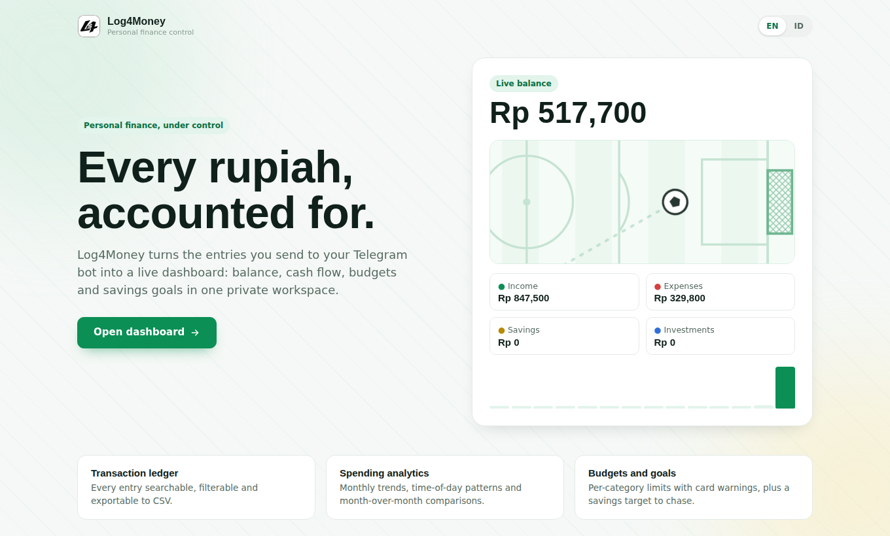
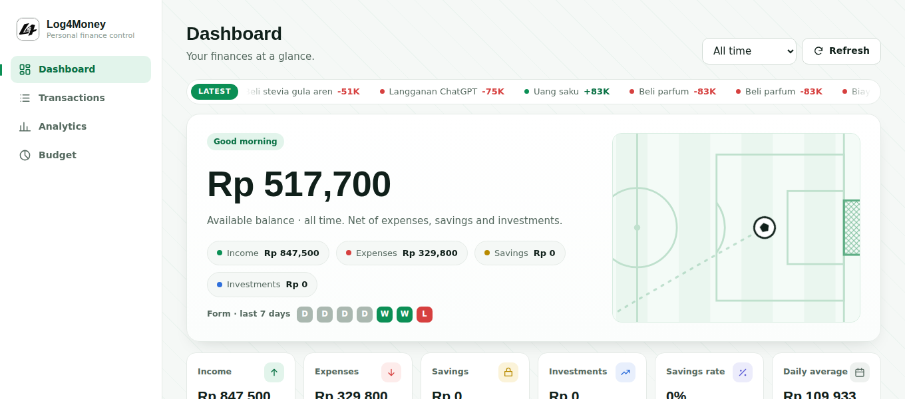
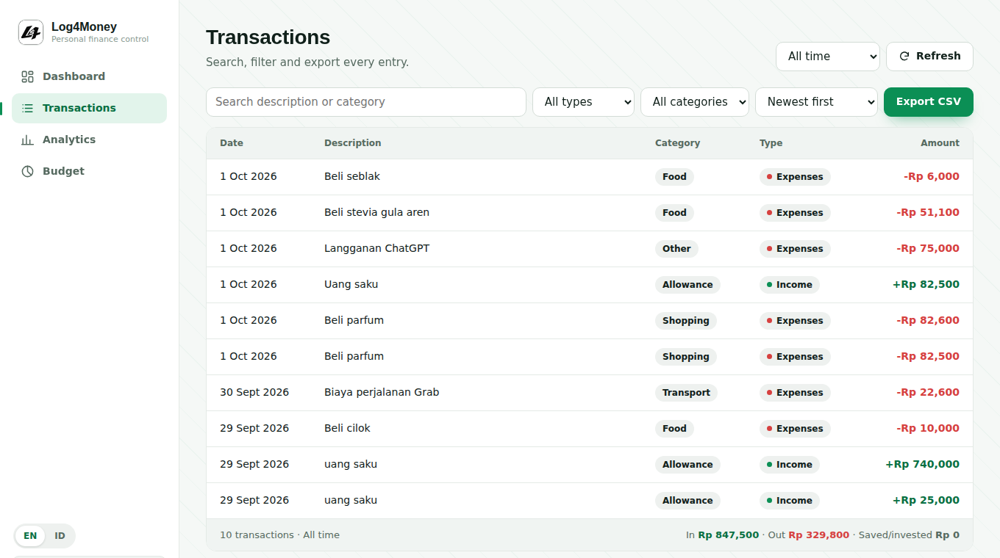
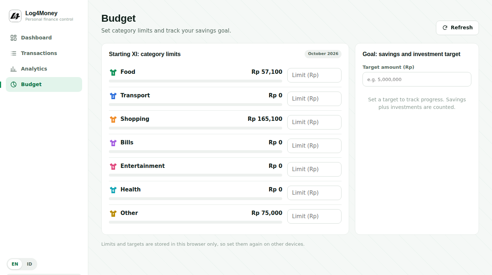
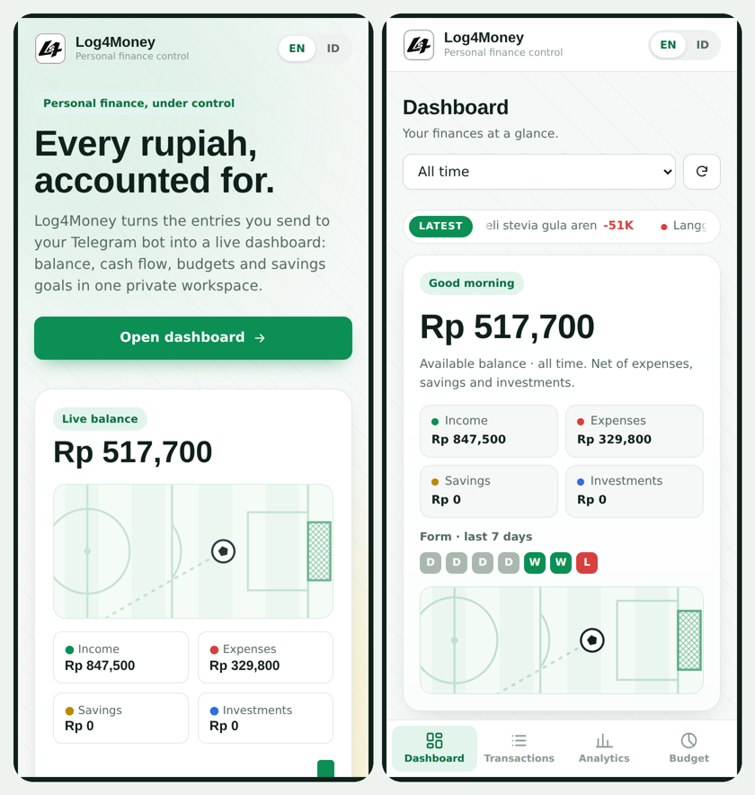
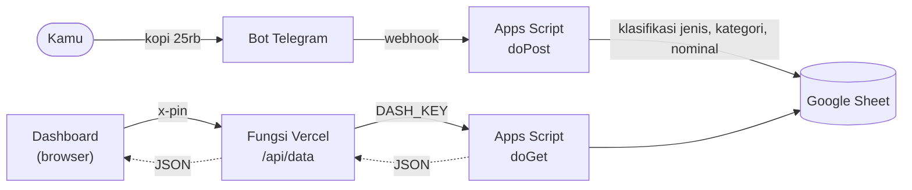

# Log4Money

**Pusat kendali keuangan pribadimu. Catat lewat Telegram, lihat di mana saja.**

Dashboard pribadi dua bahasa (EN/ID) yang mengubah pengeluaran yang kamu kirim ke bot Telegram menjadi saldo, arus kas, anggaran, dan target tabungan secara langsung. Datamu tetap ada di Google Sheet milikmu sendiri.

[English](README.md)

## Kenapa Log4Money

Kebanyakan aplikasi keuangan menyuruhmu membuka aplikasi, mengisi formulir, lalu mempercayakan data ke cloud orang lain. Log4Money membalik itu: kamu cukup mengetik `kopi 25rb` di chat, lalu catatannya diklasifikasi, disimpan di spreadsheet milikmu, dan tampil di dashboard dalam hitungan detik.

- **Mencatat tanpa ribet.** Kirim pesan biasa seperti `gaji 5jt` atau `invest emas 1jt`. Pengklasifikasi berbantuan AI (dengan cadangan kata kunci) mengenali jenis, kategori, dan nominal.
- **Datamu milikmu.** Semua tersimpan di Google Sheet. Tanpa database pihak ketiga dan tanpa langganan.
- **Untuk mengambil keputusan.** Tren, pola belanja, perbandingan antar bulan, anggaran, dan target.
- **Privat sejak awal.** Kode akses opsional yang dicek di server, ditambah kunci bersama opsional antara web dan script.

## Fitur

| Area | Isinya |
| --- | --- |
| **Dashboard** | Saldo tersedia, pemasukan, pengeluaran, tabungan, investasi, rasio menabung, dan rata-rata harian, masing-masing dengan grafik mini dan perubahan dibanding periode lalu. Ada ticker catatan terbaru, arus kas harian, rincian kategori, dan catatan otomatis. |
| **Transaksi** | Pencarian instan, filter jenis dan kategori, empat urutan, detail dengan pesan asli dari chat, dan ekspor CSV. |
| **Analitik** | Pemasukan vs pengeluaran per bulan, saldo kumulatif, pola jam dan hari belanja, pengeluaran terbesar, dan tabel perbandingan kategori antar bulan. |
| **Anggaran** | Batas bulanan per kategori dengan peringatan kartu kuning dan merah, plus target tabungan dan investasi dengan pelacak progres. |
| **Pengalaman** | Tampilan terang yang responsif untuk laptop dan HP, bahasa Inggris dan Indonesia, transisi halaman mulus, loading kerangka, dan menghormati pengaturan kurangi gerakan. |
| **Sentuhan sepak bola** | Lapangan mini yang bisa ditendang, form W/D/L untuk tujuh hari terakhir, nomor kaus di baris anggaran, dan kartu untuk pengeluaran berlebih. Halus dan tidak norak. |

## Cuplikan layar

| Dashboard | Transaksi |
| :---: | :---: |
|  |  |
| **Anggaran** | **Di HP** |
|  |  |

## Cara kerja

Sheet memakai satu baris per catatan: `Tanggal`, `Jenis`, `Deskripsi`, `Nominal`, `Kategori`, `Pesan Asli`, `Chat ID`. Jenisnya `Pemasukan`, `Pengeluaran`, `Tabungan`, dan `Investasi`. Saldo tersedia = `pemasukan - pengeluaran - tabungan - investasi`.

## Teknologi

- **Frontend:** HTML, CSS, dan JavaScript murni (tanpa build), [Chart.js](https://www.chartjs.org/) untuk grafik
- **Lapisan API:** satu fungsi serverless Vercel (`api/data.js`)
- **Backend:** Google Apps Script yang terikat ke Google Sheet, dengan webhook bot Telegram
- **Hosting:** Vercel (file statis ditambah fungsi)

## Memulai

**Prasyarat:** akun Google, bot Telegram (lewat [@BotFather](https://t.me/BotFather)), dan akun Vercel.

1. **Siapkan sheet.** Buat Google Sheet dengan kolom di atas, lalu buka *Ekstensi → Apps Script*.
2. **Tambahkan endpoint dashboard.** Pastikan `doGet` di script-mu adalah versi di [`apps-script/doGet-dashboard.gs`](apps-script/doGet-dashboard.gs). Fungsi ini tetap menjawab pengecekan bot dan mengirim JSON untuk dashboard. Deploy sebagai aplikasi web dan salin URL `/exec`. Saat memperbarui, pakai *Kelola deployment → Edit → Versi baru* supaya URL tidak berubah.
3. **Deploy situs.** Push repositori ini ke GitHub dan import di Vercel (preset: *Other*, tanpa build command).
4. **Isi environment variable** di Vercel lalu redeploy:

   | Variabel | Wajib | Fungsi |
   | --- | :---: | --- |
   | `APPS_SCRIPT_URL` | Ya | URL `/exec` Apps Script-mu |
   | `DASH_KEY` | Tidak | Kunci bersama; isi juga sebagai Properti Skrip bernama `DASH_KEY` |
   | `DASH_PIN` | Tidak | Kode akses yang mengunci seluruh dashboard |

Tanpa `APPS_SCRIPT_URL`, situs berjalan dengan data contoh bawaan, cocok untuk melihat-lihat dulu.

## Catatan keamanan

- Simpan token (token bot Telegram, kunci AI, `DASH_KEY`, `DASH_PIN`) di **Properti Skrip** atau **environment variable Vercel**. Jangan pernah di-commit.
- Dengan `DASH_PIN` aktif, `/api/data` membalas `401` tanpa kode yang benar, jadi tidak ada data keuangan yang keluar dari server. Percobaan salah sengaja diperlambat. Pilih frasa sandi yang panjang, bukan PIN pendek.
- Tanpa `DASH_PIN`, siapa pun yang punya link situsmu bisa melihat dashboard.
- Batas anggaran dan target disimpan di browser (`localStorage`) dan tidak disinkronkan antar perangkat.

## Rencana ke depan

- [ ] Tambah dan edit transaksi dari web
- [ ] PWA yang bisa di-install dengan cache offline
- [ ] Transaksi berulang dan pengingat tagihan
- [ ] Banyak dompet dan mata uang
- [ ] Impor CSV

---

Dibuat untuk pemakaian pribadi. Setiap rupiah, tercatat rapi.

