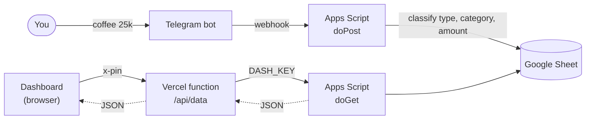

<div align="center">


# Log4Money

**Your personal finance command center. Log it in Telegram, see it everywhere.**

A private, bilingual (EN/ID) dashboard that turns the expenses you message to a Telegram bot into live balance, cash flow, budgets and savings goals. Your data stays in your own Google Sheet.


[Bahasa Indonesia](README.id.md)


</div>

## Why Log4Money

Most finance apps ask you to open them, tap through forms and trust someone else's cloud. Log4Money flips that: you type `coffee 25k` into a chat, and the entry is classified, stored in a spreadsheet you own, and reflected on a clean dashboard within seconds.

- **Zero-friction capture.** Send a plain message such as `salary 5m` or `invest gold 1m`. An AI-assisted classifier (with a keyword fallback) detects the type, category and amount.
- **You own the data.** Everything lives in your Google Sheet. No third-party database, no subscription.
- **Built for decisions, not just records.** Trends, spending patterns, month-over-month comparisons, budgets and goals.
- **Private by design.** Optional access code enforced on the server, plus an optional shared key between the web layer and the script.

## Features

| Area | What you get |
| --- | --- |
| **Dashboard** | Available balance, income, expenses, savings, investments, savings rate and daily average, each with a sparkline and period-over-period change. A live ticker of recent entries, daily cash flow, category breakdown and automatic insights. |
| **Transactions** | Instant search, filters by type and category, four sort orders, detail view with the original chat message, and CSV export. |
| **Analytics** | Income vs expenses by month, cumulative balance, spending by time of day and weekday, largest expenses and a month-over-month category table. |
| **Budget** | Per-category monthly limits with yellow and red card warnings, plus a savings and investment goal with a progress tracker. |
| **Experience** | Light, responsive UI for desktop and phone, English and Indonesian, smooth page transitions, skeleton loading and respect for reduced-motion settings. |
| **Football touch** | A mini pitch you can shoot at, a W/D/L form guide for your last seven days, shirt numbers for budget lines and cards for overspending. Subtle, never childish. |

## Screenshots

<div align="center">

| Dashboard | Transactions |
| :---: | :---: |
|  |  |
| **Budget** | **On your phone** |
|  |  |

</div>

## How it works



The sheet uses one row per entry: `Date`, `Type`, `Description`, `Amount`, `Category`, `Original message`, `Chat ID`. Types are `Pemasukan` (income), `Pengeluaran` (expense), `Tabungan` (savings) and `Investasi` (investment). Available balance is `income - expenses - savings - investments`.

## Tech stack

- **Frontend:** vanilla HTML, CSS and JavaScript (no build step), [Chart.js](https://www.chartjs.org/) for charts
- **API layer:** one Vercel serverless function (`api/data.js`)
- **Backend:** Google Apps Script bound to a Google Sheet, with a Telegram bot webhook
- **Hosting:** Vercel (static files plus the function)

## Getting started

**Prerequisites:** a Google account, a Telegram bot (via [@BotFather](https://t.me/BotFather)), a Vercel account.

1. **Prepare the sheet.** Create a Google Sheet with the columns above and open *Extensions → Apps Script*.
2. **Add the dashboard endpoint.** In your script, make sure `doGet` is the version in [`apps-script/doGet-dashboard.gs`](apps-script/doGet-dashboard.gs). It keeps answering the bot's health check and returns JSON for the dashboard. Deploy it as a web app and copy the `/exec` URL. When updating later, use *Manage deployments → Edit → New version* so the URL stays the same.
3. **Deploy the site.** Push this repository to GitHub and import it in Vercel (framework preset: *Other*, no build command).
4. **Set environment variables** in Vercel and redeploy:

   | Variable | Required | Purpose |
   | --- | :---: | --- |
   | `APPS_SCRIPT_URL` | Yes | Your Apps Script `/exec` URL |
   | `DASH_KEY` | No | Shared secret; also set it as a Script Property named `DASH_KEY` |
   | `DASH_PIN` | No | Access code that locks the whole dashboard |

Without `APPS_SCRIPT_URL` the site runs on built-in sample data, which is handy for a first look.

## Security notes

- Keep tokens (Telegram bot token, AI keys, `DASH_KEY`, `DASH_PIN`) in **Script Properties** or **Vercel environment variables**. Never commit them.
- With `DASH_PIN` set, `/api/data` returns `401` without the right code, so no financial data leaves the server. Failed attempts are deliberately slowed down. Choose a long passphrase rather than a short PIN.
- Without `DASH_PIN`, anyone with your site link can read the dashboard.
- Budget limits and goals are stored in the browser (`localStorage`) and are not synced across devices.

## Project structure

```
log4money/
├── index.html              Welcome page
├── dashboard.html          Overview
├── transactions.html       Ledger, search and export
├── analytics.html          Trends and patterns
├── budget.html             Limits and savings goal
├── api/data.js             Vercel function (PIN check, proxy to Apps Script)
├── apps-script/            doGet for the dashboard
├── css/style.css           Design system and animations
├── js/
│   ├── core.js             Data, shell, charts helpers, lock screen
│   ├── i18n.js             English and Indonesian strings
│   ├── dashboard.js · transactions.js · analytics.js · budget.js
│   └── sample.js           Demo data
└── docs/                   README screenshots
```

## Roadmap

- [ ] Add and edit transactions from the web UI
- [ ] Installable PWA with offline cache
- [ ] Recurring transactions and bill reminders
- [ ] Multiple wallets and currencies
- [ ] CSV import

---

<div align="center">Built for personal use. Every rupiah, accounted for.</div>
